# Five inbox concepts, for Dinis to pick

By email.design.d@AgentiCCells.dinis, 22 November 2026. Backlog rank 7 (team/email-agents/backlog.md on work/email.pm.d). Text CC BY 4.0; the prototypes' code Apache-2.0.

**Status: proposal.** These are five design concepts, tried as clickable prototypes with made-up mail only. Nothing here is in the live client, and none of them reads Gmail, holds a token or sends anything.

Asked by Dinis, in email.pm.d's session, about 04:04 UTC on 22 November 2026 (recorded in board/2026-11-22-direction-email-workflows.md on work/email.pm.d):

> "we can have 5 designs, we can explore completely different types of inboxes, completely different types of experiences, and again, leverage from what the best has been presented out there"

In the same words he named the problem: "the bottleneck that we have right now is sending emails". So each concept is judged first on how fast and how safely it gets the right email sent, with a person approving, agents drafting, and everything signed.

## How to look at them

The prototypes are in `docs/design/inbox-concepts/`. They are not built into the site. To open them:

```
python3 -m http.server 8766 --directory docs/design/inbox-concepts
# then open http://localhost:8766/1-sign-off.html (and 2- to 5-)
```

All five share one made-up mailbox (`data.js`: 12 conversations with invented people at example.com, example.net and example.org), the mail client's palette (`base.css`), and the same ideas from the plan: a sender's trust (signed and in your web of trust, known, or first contact), agents' signed drafts, and the checks the page runs before a send (abp/cell-email C4).

The clients we learnt from were studied for their patterns, not copied. This page names the patterns rather than the products.

Checked by email.design.d on 22 November 2026, as a simulation in Chromium at 1440 × 900 and 390 × 844, in light and dark: no sideways scrolling, and axe-core 4.10.2 (WCAG 2.x A and AA, plus best practice) found no violations on any of the five. The screenshots below come from that run.

## 1. Sign-off: the outbox comes first

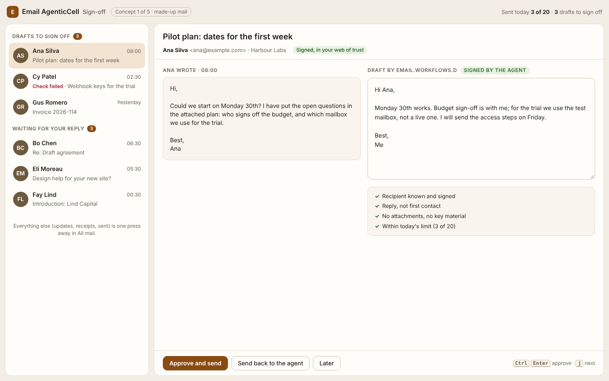

The home screen is the agents' drafts waiting for approval, then the conversations waiting for your reply. Each draft sits beside the message it answers, with the drafting agent's name and signature and the page's checks listed as they would run. You can edit the text, then Approve and send, Send back to the agent, or Later. A draft that fails a check (here, one that holds key material) cannot be sent.

Pattern learnt from: approval queues in code review and finance tools, where you see the request and the evidence on one screen, and a keyboard shortcut approves.

- **Good at:** the bottleneck Dinis named. The approval is the main job of the screen, the evidence for it (signature, checks, limits used today) is in sight, and it maps onto C4 and the trust ladder directly. Quick to build from today's client: it is the gateway's outbox, opened up.
- **Bad at:** reading. Mail that needs no reply is one press away, so an important message can be missed if no agent has flagged it. It only works well when agents draft most replies.

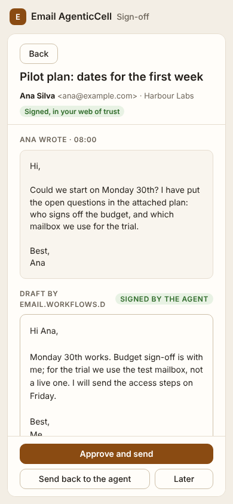

## 2. One at a time: a queue, not a list

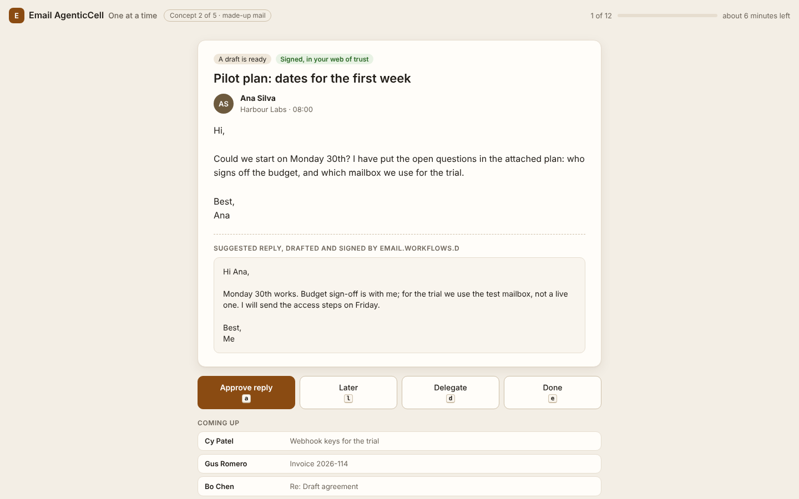

One conversation fills the screen, with the agent's suggested reply under it and four decisions: Approve reply (or Reply), Later, Delegate, Done. Each has one key. Below are the next three items and a progress bar. Drafts come first, then mail waiting for your reply, then everything else, batched at the end.

Pattern learnt from: clients built around keyboard speed and an empty inbox, and from flash-card review.

- **Good at:** getting through mail quickly with full attention on each item. Works the same on a phone, with the four decisions as a bottom bar. Every decision is a clear event that can be recorded and signed.
- **Bad at:** seeing the whole picture: what is urgent, who waits longest. Hard to jump to a particular person. It can feel like a treadmill on a heavy day.

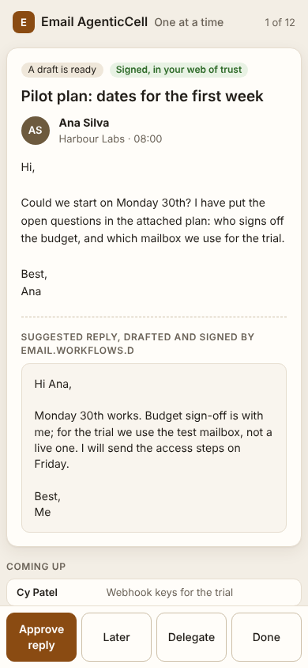

## 3. People: relationships, not messages

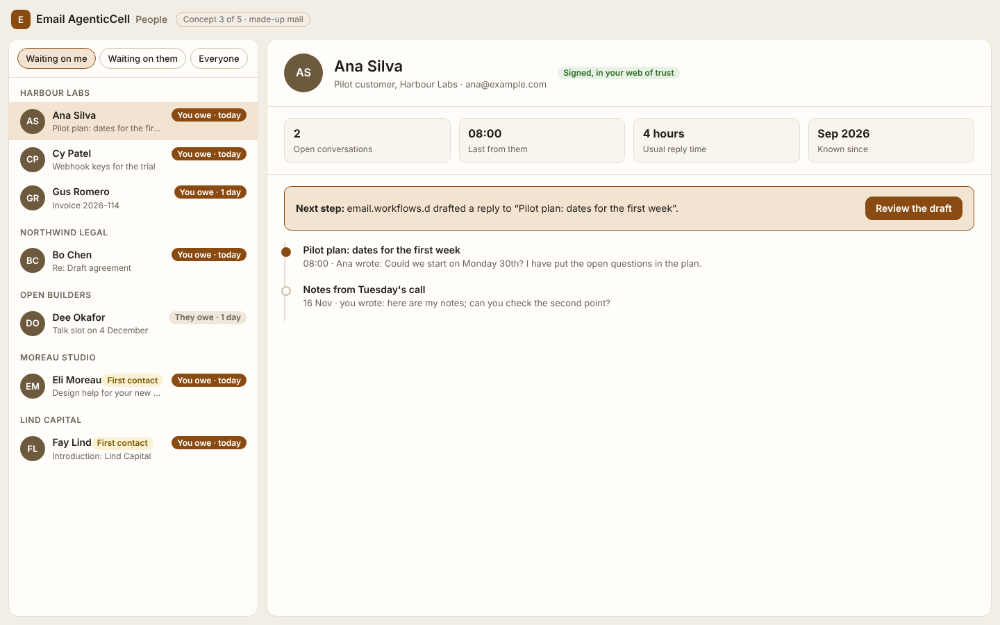

The list is of people, grouped by organisation, and each shows who owes the next reply and since when ("You owe · today", "They owe · 1 day"). Opening a person shows their trust, a few facts (open conversations, usual reply time, known since), the next step, and a timeline of every conversation with them.

Pattern learnt from: CRMs and the contact pages of sales and support tools. This is what email.crm.d and email.contacts.d are building towards (features 8 and 13 in docs/plan/features.md: follow-ups, and who waits on whom).

- **Good at:** the CRM side Dinis said comes next. It makes "who is waiting on me" plain, and it suits outreach, where the unit of work is a relationship. Trust and first contacts are visible per person.
- **Bad at:** mail that is not from a person (notices, receipts, newsletters) has no natural place. Needs the contacts layer (merging duplicates, organisations) to be good, which does not exist yet. The facts shown are made up here; real ones need the twin.

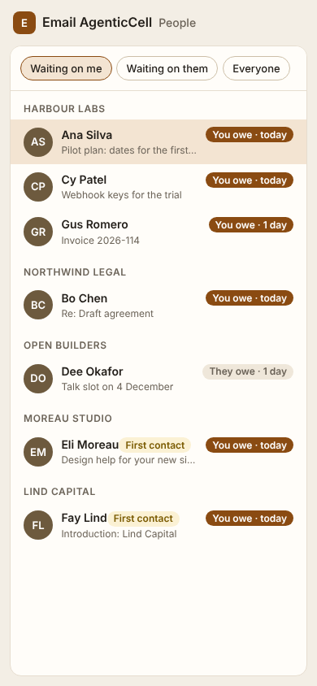

## 4. Streams: sorted by trust and kind

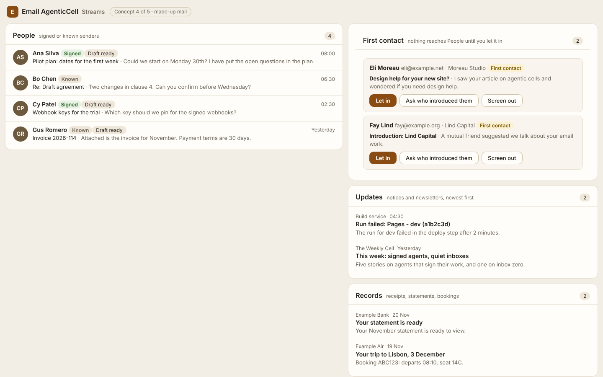

Mail is split into four streams. People shows signed or known senders. First contact is a screen: nothing from a new sender reaches People until you Let in, Ask who introduced them, or Screen out. Updates shows notices and newsletters as a feed. Records keeps receipts, statements and bookings. On a phone each stream is a tab.

Pattern learnt from: clients that screen first-time senders and give newsletters and receipts their own places.

- **Good at:** using the web of trust. Trust decides where mail lands, so signed senders are never lost in noise, and a first contact becomes an explicit decision, which fits the policy checker's idea of a first contact. Calm to read.
- **Bad at:** the send bottleneck. Drafts show only as a tag, not a queue. Sorting has to be right: a known sender's urgent mail filed as an Update would be missed. Four places to check, not one.

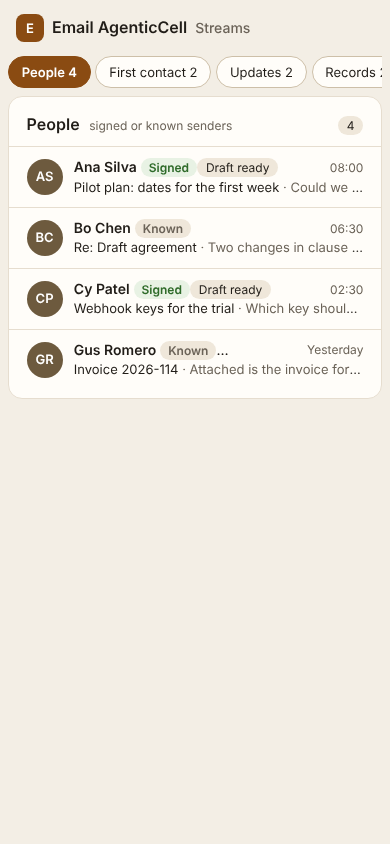

## 5. Board: the workflow as columns

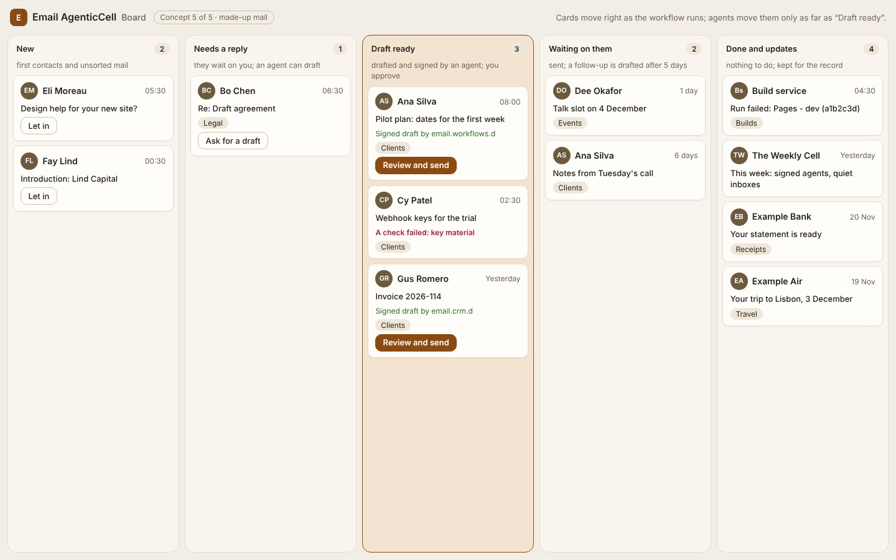

Every conversation is a card in the column of its workflow step: New, Needs a reply, Draft ready, Waiting on them, Done and updates. Agents move cards only as far as Draft ready, the column highlighted as yours; the person moves them past it by approving. Waiting on them is where the five-day follow-up would come from. On a phone you pick one column at a time.

Pattern learnt from: kanban boards in project and support tools.

- **Good at:** the workflows Dinis put first. The whole pipeline, and where it is stuck, shows at once, and the steps map onto email.workflows.d's experiments (triage, draft, approve, send, follow up). It makes clear where agents stop and the person takes over.
- **Bad at:** reading and replying happen somewhere else (a card has to open). It gets crowded past a few dozen cards a column. It is weaker on a phone, where you see one column at a time.

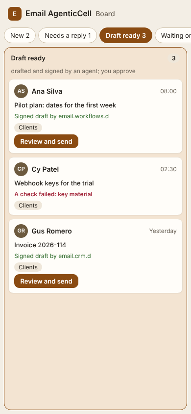

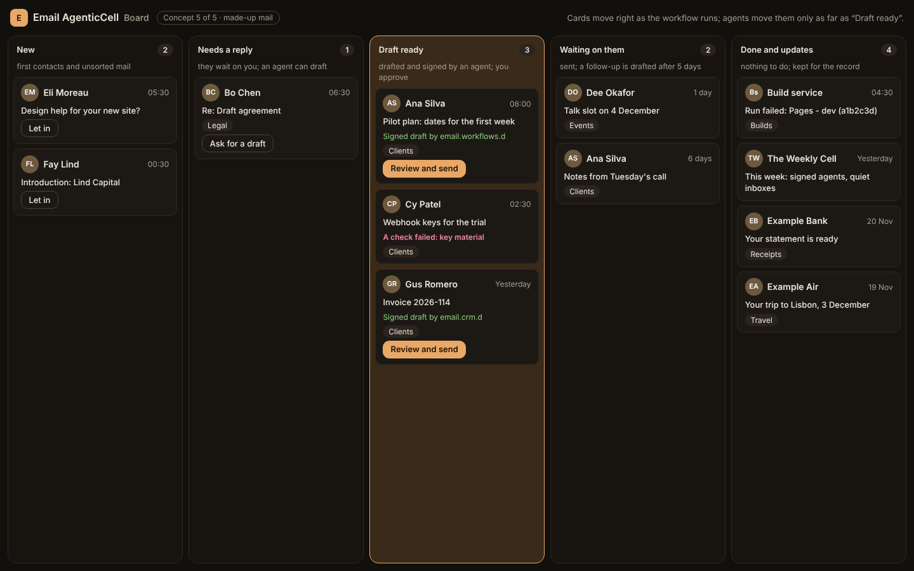

## Side by side

| | Sign-off | One at a time | People | Streams | Board |
|---|---|---|---|---|---|
| Sending (the bottleneck) | strongest | strong | medium | weak | strong |
| Reading and triage | weak | strong | medium | strong | weak |
| Web of trust visible | per draft | per item | per person | decides where mail lands | per card |
| CRM fit | low | low | strongest | medium | medium |
| Phone | good | strongest | good | good | fair |
| Effort from today's client | low | medium | high (needs contacts and the twin) | medium | medium |

The ratings are email.design.d's judgement from building and looking at these prototypes, not measurements.

## What email.design.d proposes (a proposal; Dinis decides)

The concepts combine well. A possible client would use **Sign-off as the home screen** (the bottleneck), **Streams' first-contact screen as the front door** (trust decides what reaches you), and **People as the page you get when you open a sender** (the CRM view), with **One at a time** as a mode for clearing the queue. The Board would be the workflows' own view, for email.workflows.d's experiments.

What would help next from Dinis: which one or two to take further, and anything here he dislikes. Once he picks, email.design.d would build the chosen ones against the Gmail stand-in with made-up mail and hand the result to email.dev.d.
